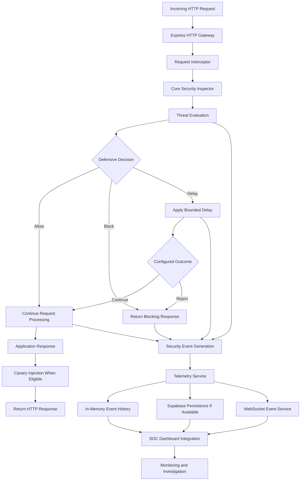

 <div align="center">

# Wotmed-Net (ወጥመድ-ኔት)

### Active Defense Middleware Mesh

**Catch Threats Before They Reach the Core.**

An application-layer security prototype combining request inspection, threat evaluation, active defensive responses, canary-based detection, security telemetry, and SOC-oriented monitoring.

[](https://github.com/Spectacular-insa)
[](https://nodejs.org/)
[](https://expressjs.com/)
[](https://react.dev/)
[](https://supabase.com/)

[Overview](#-overview) · [Architecture](#-how-it-works) · [Features](#-core-capabilities) · [Installation](#-getting-started) · [Testing](#-testing-and-verification) · [Team](#-project-team)

</div>

---

## 📌 Table of Contents

- [Overview](#-overview)
- [The Problem](#-the-problem)
- [Project Objectives](#-project-objectives)
- [What Makes Wotmed-Net Different?](#-what-makes-wotmed-net-different)
- [Core Capabilities](#-core-capabilities)
- [How It Works](#-how-it-works)
- [System Architecture](#-system-architecture)
- [Technology Stack](#-technology-stack)
- [Repository Structure](#-repository-structure)
- [Getting Started](#-getting-started)
- [Environment Configuration](#-environment-configuration)
- [Database and Telemetry](#-database-and-telemetry)
- [Testing and Verification](#-testing-and-verification)
- [Screenshots and Demonstration](#-screenshots-and-demonstration)
- [Implementation Status](#-implementation-status)
- [Limitations and Future Development](#-limitations-and-future-development)
- [Security and Responsible Use](#-security-and-responsible-use)
- [Project Team](#-project-team)
- [Acknowledgments](#-acknowledgments)
- [References](#-references)
- [License](#-license)

---

## 🚀 Overview

**Wotmed-Net (ወጥመድ-ኔት)** is an application-layer active defense and security monitoring prototype developed by a five-member team for the INSA Cyber Talent graduation project.

Traditional request filtering focuses primarily on deciding whether web traffic should be allowed or rejected. Wotmed-Net explores a broader approach by connecting request inspection, threat evaluation, defensive response mechanisms, canary-based detection, and security telemetry within a modular architecture.

The project is designed to examine how suspicious application-layer requests can be identified, how defensive actions can be applied, and how security events can be recorded for further investigation.

### Project at a Glance

| Attribute | Details |
|---|---|
| Project | Wotmed-Net (ወጥመድ-ኔት) |
| Architecture | Active Defense Middleware Mesh |
| Category | Application Security / Defensive Cybersecurity |
| Academic program | INSA Cyber Talent — 5th Batch |
| Backend runtime | Node.js |
| HTTP framework | Express |
| Dashboard framework | React / Next.js |
| Telemetry integration | Supabase |
| Live communication | WebSocket-based backend service |
| Development approach | Modular implementation and controlled testing |
| GitHub repository | [Spectacular-insa/wotmed-net](https://github.com/Spectacular-insa/wotmed-net) |

> **Development status:** Wotmed-Net is a prototype, not a production-certified security product. Individual mechanisms, database persistence, and dashboard integrations must be evaluated separately. See [Implementation Status](#-implementation-status) for important integration qualifications.

---

## 🎯 The Problem

Web applications receive legitimate traffic alongside requests that may contain malicious payloads, automated scanner probes, or attempts to access sensitive resources.

Detecting suspicious requests is only one part of an effective defensive workflow. Security operators also need information about what triggered a detection, which action was taken, and whether the incident was recorded and delivered to monitoring tools.

Common challenges include:

- Detecting selected attack patterns in incoming HTTP requests.
- Making defensive decisions based on inspection results.
- Applying blocking or delay mechanisms where appropriate.
- Using canary markers as an additional detection mechanism.
- Recording security events for investigation.
- Connecting backend telemetry with a monitoring interface.
- Evaluating false positives, false negatives, and integration failures.

Wotmed-Net addresses these challenges through a prototype that brings several defensive mechanisms together rather than treating request filtering as the only security function.

---

## 🎯 Project Objectives

### General Objective

To design, implement, and evaluate a modular application-layer active defense platform that integrates heuristic HTTP request inspection, threat evaluation, defensive responses, canary-based detection, and security telemetry.

### Specific Objectives

1. Develop a modular architecture for request inspection and defensive middleware.
2. Implement rule-based detection for selected suspicious HTTP request patterns.
3. Evaluate inspection findings and apply configured defensive decisions.
4. Implement blocking and bounded-delay responses where supported by the current middleware.
5. Explore canary-based detection through identifiable markers in eligible responses.
6. Generate and retain security-event information for monitoring and analysis.
7. Integrate backend telemetry with a SOC-oriented dashboard.
8. Test detection rules, response handling, and component communication in a controlled environment.
9. Identify implementation limitations and define improvements for reliability, scalability, and security.

---

## 🛡️ What Makes Wotmed-Net Different?

Wotmed-Net explores a combination of defensive mechanisms rather than relying exclusively on request filtering.

| Security layer | Purpose |
|---|---|
| Request inspection | Identify selected suspicious request patterns. |
| Threat evaluation | Interpret inspection results for defensive decisions. |
| Active response | Block or delay requests according to implemented logic. |
| Canary-based detection | Use identifiable markers to support detection of suspicious interactions. |
| Security telemetry | Generate records of security-related events. |
| Persistence | Support database-backed incident storage when configured and operational. |
| SOC-oriented monitoring | Provide an interface for reviewing available security information. |
| Modular architecture | Separate security processing, telemetry, and dashboard responsibilities. |

The intended advantage is the integration of **detection, response, deception-related techniques, and monitoring** in one application-layer architecture.

Wotmed-Net should not be confused with a complete enterprise WAF, a fully developed honeypot platform, or a mature SIEM. The project provides a foundation for implementing and evaluating these combined defensive concepts.

---

## ⚙️ Core Capabilities


### 1. Heuristic HTTP Request Inspection

The core inspection engine evaluates selected HTTP request characteristics using configured detection rules.

Detection logic includes patterns associated with:

- SQL injection.
- Cross-site scripting (XSS).
- Path traversal.
- Server-side request forgery (SSRF)-related input patterns.
- Known automated scanner signatures.
- Suspicious or missing HTTP headers.

These checks are heuristic and rule-based. They do not guarantee detection of every attack variant.

### 2. Threat Evaluation

Inspection findings are passed to the defensive logic for evaluation. Configured rules, scores, and thresholds influence the selected response where implemented.

Detection accuracy depends on rule quality, threshold configuration, and testing against representative traffic.

### 3. Active Defensive Responses

The middleware supports defensive actions, including request blocking and bounded response delays.

The current blocking behavior returns a denial response. A functioning honeypot redirection is a separate capability and should not be claimed unless implemented and verified.

### 4. Canary-Based Detection

The interceptor can inject identifiable canary markers into eligible JSON responses.

These markers can help identify suspicious interaction with marked data. Their presence alone does not prove that an attacker has accessed or exploited a system.

### 5. Security Telemetry

The telemetry service processes security-event information generated by defensive components.

The project includes bounded in-memory event history and a Supabase integration intended for persistent storage. Successful database writes and retrieval depend on the configured environment and must be verified.

### 6. WebSocket Event Service

The backend provides a WebSocket service intended to communicate security events to monitoring clients.

End-to-end event delivery depends on compatible client protocols, correct connection settings, and consistent event formats.

### 7. Security Operations Center (SOC) Dashboard

The dashboard provides the intended graphical interface for security monitoring.

Complete integration depends on the required API endpoints being available and the frontend and backend communication protocols being compatible.

### 8. Controlled Security Testing

Wotmed-Net can be evaluated using authorized test requests designed to exercise selected detection rules and defensive response paths.

For each test, record:

- The request and test scenario.
- The expected and actual HTTP response.
- The detected rule or classification.
- The selected defensive action.
- Any corresponding telemetry event.


---

## 🔄 How It Works

The following **static Mermaid flowchart** shows the request-processing and telemetry architecture. It is designed to render as a diagram on GitHub rather than continuously rotate, animate, or refresh.



### Request Lifecycle

1. **Receive:** The Express gateway receives an HTTP request.
2. **Inspect:** The interceptor and inspection engine evaluate selected request attributes.
3. **Evaluate:** The defensive logic interprets the inspection findings.
4. **Respond:** The middleware allows, blocks, or delays the request according to its configured logic.
5. **Generate events:** Relevant processing and detection outcomes can produce security-event information.
6. **Store and communicate:** The telemetry service maintains recent event history and attempts configured persistence and event communication.
7. **Monitor:** The SOC dashboard can display information that its integrations successfully receive.


---

## 🏗️ System Architecture

Wotmed-Net is organized around the following logical components.

| Component | Responsibility |
|---|---|
| Core Security Engine | Implements request inspection and detection rules. |
| Request Interceptor | Captures request context and supports interception-related mechanisms. |
| Defense Middleware | Connects inspection and evaluation to HTTP responses. |
| Reference / Demo Application | Provides a controlled environment for exercising the security pipeline. |
| Backend Telemetry | Processes incident information and maintains recent event history. |
| Supabase Integration | Supports persistent incident storage when correctly configured. |
| WebSocket Service | Provides a backend channel for live-event communication. |
| SOC Dashboard | Provides a graphical interface for security monitoring. |
| Security Testing | Supports controlled verification of selected behaviors. |

The implementation is intended to keep security processing, telemetry, and monitoring responsibilities modular so they can be tested and improved independently.

---

## 🧰 Technology Stack

### Backend and Security Engine

| Technology | Purpose |
|---|---|
| Node.js | Server-side JavaScript runtime. |
| Express | HTTP gateway and middleware framework. |
| JavaScript | Request inspection, defensive logic, and server implementation. |
| `ws` | Backend WebSocket communication. |
| Supabase client | Database integration for telemetry persistence. |

### Dashboard and Interface

| Technology | Purpose |
|---|---|
| React | User-interface components. |
| Next.js | Dashboard application framework. |
| TypeScript | Type-safe frontend development where used. |
| Tailwind CSS | Dashboard styling. |
| Socket.IO client dependency | Used in parts of the existing frontend; compatibility with the backend's raw WebSocket service must be addressed where applicable. |

### Development and Collaboration

- Git and GitHub for source control and collaboration.
- npm for dependency installation and package management.
- Environment variables for local service configuration.
- Controlled HTTP requests for manual security verification.

---

## 📁 Repository Structure

The following is a high-level map of the project. Refer to the repository for the current file names and contents.

```text
wotmed-net/
├── core-engine/          # Inspection and security decision logic
├── middleware/           # Request interception and defensive middleware
├── backend-telemetry/    # Telemetry-related components, where present
├── demo-app/             # Reference application, where present
├── security-tests/       # Security testing resources, where present
├── docs/                 # Technical documentation, where present
├── soc-dashboard/        # SOC dashboard application
├── server.js             # Backend entry point
├── package.json          # Root dependencies and scripts
├── .gitignore
├── LICENSE               # Include if the repository contains this file
└── README.md
```

Directory names marked “where present” are intended to avoid implying that a particular folder or implementation exists if the repository structure changes.

---

## 💻 Getting Started

These instructions describe running the existing repository locally. Wotmed-Net should not be installed using `npm install wotmed-net` unless a published npm package has actually been created.

### Prerequisites

Install the following:

- [Node.js](https://nodejs.org/)
- npm
- [Git](https://git-scm.com/)
- A modern web browser
- A Supabase project if persistent telemetry storage is required

### 1. Clone the Repository

```bash
git clone https://github.com/Spectacular-insa/wotmed-net.git
cd wotmed-net
```

### 2. Install Backend Dependencies

```bash
npm install
```

### 3. Configure Environment Variables

Create a `.env` file in the repository root using the variable names required by the current code.

Example template:

```dotenv
PORT=5000
WS_PORT=3001

SUPABASE_URL=your_supabase_project_url
SUPABASE_SECRET_KEY=your_server_side_secret
```

The values are placeholders, not working credentials. Confirm the environment-variable names in the current backend and telemetry code before using the file.

**Never commit real credentials, API keys, database secrets, access tokens, or production environment files.**

### 4. Start the Backend

From the repository root:

```bash
node server.js
```

The expected local configuration is:

| Service | Default address |
|---|---|
| HTTP gateway | `http://localhost:5000` |
| WebSocket service | `ws://localhost:3001` |

These ports reflect the development configuration and may vary according to the actual code and environment. Confirm that both services start successfully by checking the terminal output.

### 5. Test the HTTP Gateway

Open a second terminal:

```bash
curl.exe -i "http://localhost:5000/"
```

A successful HTTP response confirms that the gateway responds to the request. It does not by itself confirm that every security feature or telemetry integration is working.

### 6. Install Dashboard Dependencies

Open a separate terminal:

```bash
cd soc-dashboard
npm install
```

### 7. Configure the Dashboard

Create `soc-dashboard/.env.local`:

```dotenv
NEXT_PUBLIC_API_URL=http://localhost:5000/api
NEXT_PUBLIC_WS_URL=ws://localhost:3001
```

These are example values. The actual API base path and WebSocket URL must match the current frontend and backend implementations.

### 8. Run the Dashboard

From the `soc-dashboard` directory:

```bash
npm run dev
```

Open the local URL printed by Next.js, commonly:

```text
http://localhost:3000
```

Keep the backend and dashboard running in separate terminals.

> **Integration warning:** The existing dashboard has expected API paths and a Socket.IO client dependency, while the backend uses a raw WebSocket service. Socket.IO and raw WebSocket are not interchangeable. Some dashboard functions may fail until the routes, ports, event formats, and communication protocols are aligned.

---

## 🔐 Environment Configuration

### Backend Settings

| Variable | Purpose |
|---|---|
| `PORT` | HTTP gateway port, if read by the server. |
| `WS_PORT` | WebSocket service port, if read by the server. |
| `SUPABASE_URL` | Supabase project endpoint, if this is the variable expected by the code. |
| `SUPABASE_SECRET_KEY` | Server-side credential, if this is the variable expected by the code. |

Environment-variable names must match the implementation. This table is a configuration guide, not a claim that every variable is read by every component.

### Configuration Security

- Keep `.env` and `.env.local` out of version control.
- Use server-side database credentials only in trusted backend code.
- Never expose a Supabase secret key through a public frontend environment variable.
- Use narrowly scoped database permissions.
- Rotate credentials immediately if they are exposed.
- Audit the Git history before making the repository public.

---

## 🗄️ Database and Telemetry

Wotmed-Net integrates Supabase for security-incident storage and uses an in-memory event history for recent telemetry.

### Intended Telemetry Workflow

1. The inspection and defense components identify a relevant event.
2. The telemetry service receives the event information.
3. The event is retained in the in-memory history, subject to the implementation's limits.
4. The service attempts persistent storage if Supabase is configured.
5. The WebSocket service can communicate supported events to connected clients.
6. Monitoring components can consume the information they successfully receive.

### Database Verification

Before claiming that persistent logging is operational, verify all of the following:

- The expected database table and schema exist.
- The server uses the correct Supabase project and credentials.
- A controlled event can be inserted successfully.
- The stored event can be retrieved.
- Database connection and write errors are handled.
- Sensitive request data is not unnecessarily retained.

The current implementation has used a `wotmed_incidents` table name. Confirm that the actual Supabase schema matches the code before relying on that name.

### In-Memory vs. Persistent Storage

| Storage method | Behavior |
|---|---|
| In-memory history | Holds recent events during the server process; data may be lost when the process restarts. |
| Supabase persistence | Intended to retain incidents beyond the process lifetime, provided configuration, schema, connectivity, and write operations work correctly. |

The current repository should not be described as using MySQL for persistent threat logging or IP reputation unless a working MySQL implementation is present. Supabase/PostgreSQL and MySQL are different database technologies.

---

## 🧪 Testing and Verification

All testing must be performed against systems you own or have explicit permission to assess.

### Test 1: Normal Request

```bash
curl.exe -i "http://localhost:5000/"
```

Verify the HTTP status, response body, and backend logs.

### Test 2: SQL-Injection Pattern

```bash
curl.exe -i "http://localhost:5000/?id=1%20OR%201=1"
```

Inspect the actual response and confirm whether the relevant detection rule triggers. Record the status code and action instead of assuming that the request was blocked.

### Test 3: Inspect Backend Logs

Observe the server terminal while sending the controlled requests.

Record:

- Detection indicator or rule name.
- Threat score, if generated.
- Selected defensive action.
- HTTP status and response.
- Telemetry event creation.
- Any runtime, database, or network errors.

### Recommended Test Matrix

| Test case | Verification goal |
|---|---|
| Normal HTTP request | Confirm expected gateway behavior. |
| SQL-injection pattern | Verify the relevant inspection rule and response. |
| XSS test input | Verify whether the configured rule identifies the input. |
| Path-traversal test input | Verify the implemented detection logic. |
| Scanner-like user-agent | Verify scanner-signature matching. |
| Canary marker | Confirm injection into an eligible response. |
| Blocking response | Confirm the actual status and response body. |
| Delay response | Measure the actual delay and resulting HTTP response. |
| Telemetry event | Confirm event generation and in-memory retention. |
| Supabase persistence | Confirm successful insertion and retrieval. |
| WebSocket delivery | Confirm a compatible client receives the expected event. |
| Dashboard integration | Confirm the relevant API data and live events appear correctly. |

### Test Evidence

Record results in a reproducible format:

| Field | Example of what to record |
|---|---|
| Test ID | `TEST-01` |
| Input | Controlled request used |
| Expected behavior | Behavior defined by the implemented rule |
| Actual result | Observed status, logs, and response |
| Telemetry | Whether an event was generated and stored |
| Result | Pass / Fail / Not tested |


---

## 🖼️ Screenshots and Demonstration


### 1. Project Overview / Main Dashboard


<p align="center">
  
</p>

<p align="center"><em>Figure 1. Wotmed-Net Security Operations Center (SOC) dashboard.</em></p>


### 2. Request Inspection and Defensive Response

<p align="center">
  
</p>

<p align="center">
  <em>Figure 2. Request inspection and defensive response during security testing.</em>
</p>


### 3. Security Telemetry and Incident Records

<p align="center">
  
</p>

<p align="center">
  <em>Figure 3. Security telemetry and incident records from the Wotmed-Net system.</em>
</p>


### 5. Demo Video

> **Demo video coming soon.**
>
> A recorded demonstration of Wotmed-Net is planned. It will showcase the running security gateway, controlled request-inspection tests, actual defensive responses, backend telemetry, and verified dashboard functionality.


---

## 📊 Implementation Status

Wotmed-Net combines implemented components with integrations that require further verification.

| Capability | Documentation status |
|---|---|
| Express HTTP gateway | Present in the backend implementation. |
| Rule-based request inspection | Implemented for selected patterns. |
| Request interception and threat evaluation | Present; test the relevant paths. |
| Blocking response | Implemented behavior must be validated against the running build. |
| Bounded defensive delay | Present in the middleware logic; verify actual timing and outcomes. |
| Canary injection | Implemented for eligible responses. |
| In-memory incident history | Present in the telemetry implementation. |
| Supabase persistence | Integration exists; successful writes and reads must be verified. |
| Backend WebSocket service | Present; end-to-end delivery must be tested. |
| Complete SOC dashboard integration | Requires API and communication compatibility checks. |
| Actual honeypot redirection | Do not claim as operational without a verified honeypot destination and routing implementation. |
| Persistent IP reputation and automatic IP blocking | Do not claim as complete without verified implementation and tests. |
| Production-grade detection accuracy | Not established by the current prototype. |

---

## 🚧 Limitations and Future Development

### Current Limitations

- **Rule coverage:** Pattern-based inspection cannot identify every attack variation.
- **False positives and false negatives:** Legitimate requests may trigger rules, and malicious requests may evade them.
- **Threat evaluation:** Scoring and thresholds require systematic testing and calibration.
- **Deception mechanisms:** Canary markers do not constitute a complete honeypot or prove a compromise on their own.
- **IP reputation:** Rate limiting and request inspection are not equivalent to a persistent, comprehensive IP reputation system.
- **Persistence:** Database storage depends on connectivity, schema compatibility, and successful write operations.
- **Dashboard integration:** API route and live-event protocol mismatches can prevent complete monitoring.
- **Performance:** Request latency and resource consumption have not been established under representative production load.
- **Production readiness:** The project requires further security review, testing, and hardening before deployment as a protective service for critical applications.

### Future Development Roadmap

1. **Detection improvements:** Expand and evaluate rules against a structured set of benign and malicious test cases.
2. **Threat scoring:** Define documented scoring rules and validate thresholds against test results.
3. **Honeypot integration:** Implement a dedicated, isolated deception environment and verified routing behavior.
4. **IP reputation management:** Develop persistent reputation records, expiry rules, and carefully controlled blocking if required.
5. **Telemetry reliability:** Improve event schemas, error handling, retries, and persistence validation.
6. **Dashboard integration:** Align API endpoints, response schemas, WebSocket protocols, and connection lifecycle handling.
7. **Testing automation:** Add repeatable unit, integration, and security regression tests.
8. **Performance evaluation:** Measure throughput, response latency, and resource consumption under controlled load.
9. **Deployment hardening:** Add production configuration, access control, monitoring, and secure operational procedures.

---

## 🔒 Security and Responsible Use

Wotmed-Net is intended for authorized defensive research, educational demonstrations, and controlled testing.

- Test only systems you own or are explicitly authorized to assess.
- Do not use the project to disrupt services, access private information, or conduct unauthorized attacks.
- Keep database secrets and other credentials out of source control.
- Restrict access to administrative and monitoring endpoints.
- Avoid retaining full sensitive request payloads unless necessary and properly protected.
- Sanitize untrusted data before displaying it in a dashboard.
- Treat canary markers, threat scores, and detection results as security indicators rather than conclusive proof of malicious activity.
- Isolate any future honeypot environment from production systems and sensitive internal resources.
- Review dependencies and deployment settings before exposing the service to external traffic.

---

## 👥 Project Team

**INSA Cyber Talent — 5th Batch Graduation Project**

The team consists of five members collaborating on security-engine development, middleware, telemetry, dashboard development, testing, and integration.

| Team member | Student ID | Proposed project role | GitHub |
|---|---|---|---|
| **Ayitegeb Tilahun Demissie** | CTC-773-26 | Lead System Engineer — architecture, core security engine, and integration | [@ayitegebelon](https://github.com/ayitegebelon) |
| **Dilargachew Ashenafi Tsege-mariam** | CTC-1287-26 | Backend and Telemetry Engineer — incident processing and event communication | [@dilargachew-dev](https://github.com/dilargachew-dev) |
| **Biruk Zelalem Yohannes** | CTC-3770-26 | SOC Dashboard Engineer — monitoring interface and frontend integration | [@biru34](https://github.com/biru34) |
| **Eman Mohammednur Ahmed** | CTC-060-26 | Demo Application and Integration Testing — reference application and defensive behavior validation | [@Emanmohammednur](https://github.com/Emanmohammednur) |
| **Wubalem Gashaw Abera** | CTC-3704-26 | Security Testing and Documentation — controlled security tests and technical documentation | [@WUBALEM844](https://github.com/WUBALEM844) |

### Project Mentor

**Getachew Getu**  
GitHub: [@Getachew0557](https://github.com/Getachew0557)

---

## 🤝 Acknowledgments

We acknowledge the INSA Cyber Talent program for providing the training and project context for this work.

We also acknowledge our mentor and everyone who contributed feedback, testing, technical guidance, and collaboration during the development of Wotmed-Net.

---

## 📚 References

The following resources provide background for the security concepts and technologies used in the project.

1. **OWASP Top 10** — Web application security risks.  
   https://owasp.org/www-project-top-ten/

2. **OWASP Web Security Testing Guide** — Guidance for structured web application security testing.  
   https://owasp.org/www-project-web-security-testing-guide/

3. **OWASP Cross Site Scripting Prevention Cheat Sheet** — Guidance on preventing XSS.  
   https://cheatsheetseries.owasp.org/cheatsheets/Cross_Site_Scripting_Prevention_Cheat_Sheet.html

4. **OWASP SQL Injection Prevention Cheat Sheet** — Guidance on SQL injection prevention.  
   https://cheatsheetseries.owasp.org/cheatsheets/SQL_Injection_Prevention_Cheat_Sheet.html

5. **Node.js Documentation** — Runtime and API documentation.  
   https://nodejs.org/docs/

6. **Express Documentation** — HTTP application and middleware documentation.  
   https://expressjs.com/

7. **Supabase Documentation** — Database and client integration documentation.  
   https://supabase.com/docs

8. **Next.js Documentation** — Dashboard application framework documentation.  
   https://nextjs.org/docs
---

## 📄 License
 This project is licensed under the MIT License. See the [LICENSE](LICENSE) file for details.


---

<div align="center">

**Wotmed-Net — Catch Threats Before They Reach the Core.**

*An INSA Cyber Talent graduation project exploring modular application-layer active defense.*

[Repository](https://github.com/Spectacular-insa/wotmed-net) · [Spectacular](https://github.com/ayitegebelon) · [INSA Cyber Talent](https://github.com/Spectacular-insa)

</div>
