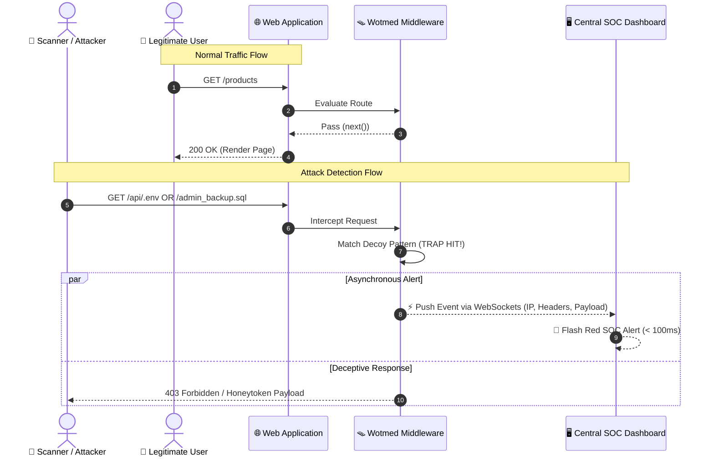

<div align="center">

# 🪤 Wotmed-Net (ወጥመድ-ኔት)

### *"Catch Threats Before They Reach the Core."*

[](https://github.com/Spectacular-insa)
[](https://opensource.org/licenses/MIT)
[]()
[]()

**An application-layer active deception engine that transforms standard web applications into interactive honeypots with a single line of middleware.**

[Explore Docs](#-system-architecture--data-flow) • [Quick Start](#-quick-start) • [Team](#-team-group-1---insa-cyber-camp)

---

</div>

## 🚀 Overview

**Wotmed-Net** is an in-code active defense system engineered for modern web infrastructure. Instead of relying purely on boundary firewalls, Wotmed-Net embeds intelligent, zero-latency decoy traps directly inside application route handlers.

* ⚡ **Zero-Latency Overhead:** Legitimate traffic passes through unhindered.
* 🎯 **Zero False Positives:** Regular users never browse honeypot paths; every hit is a guaranteed threat actor.
* 📡 **Real-Time SOC Streaming:** Instant telemetry dispatch via WebSockets (< 100ms response).

---

## 🛠️ Technology Stack

### **Core Engine & Backend**

* **Node.js & Express**: High-speed asynchronous middleware framework.
* **Supabase & PostgreSQL**: Robust database schema design and connection pooling.
* **MySQL**: Persistent threat logging and IP reputation tracking.

### **Frontend & Interface**

* **React.js & Next.js**: Component-driven single-page architecture for the threat operations UI.
* **Tailwind CSS**: Tactical dark-mode styling optimized for security analysts.

---

## ⚡ Quick Start

### Installation

```bash
npm install wotmed-net---
```

### Basic Usage

Add Wotmed-Net to your Express application with a single line:

```typescript
import express from 'express';
import { wotmedNet } from 'wotmed-net---';

const app = express();

// Enable Wotmed-Net security middleware
app.use(wotmedNet());

app.get('/', (req, res) => {
  res.send('Hello World');
});

app.listen(3000);
```

### Advanced Configuration

```typescript
app.use(wotmedNet({
  enableTarpit: true,
  decayIntervalMs: 30000,
  supabaseUrl: 'https://your-project.supabase.co',
  supabaseKey: 'your-anon-key',
  tarpitDelayMs: 2000,
  tarpitThreshold: 30,
  blockThreshold: 70
}));
```

### Configuration Options

| Option            | Type    | Default     | Description                                      |
| ----------------- | ------- | ----------- | ------------------------------------------------ |
| `enableTarpit`    | boolean | `true`      | Enable tarpitting (delaying suspicious requests) |
| `decayIntervalMs` | number  | `60000`     | Score decay interval in milliseconds             |
| `supabaseUrl`     | string  | `undefined` | Supabase project URL for persistence             |
| `supabaseKey`     | string  | `undefined` | Supabase anon key for persistence                |
| `tarpitDelayMs`   | number  | `2000`      | Custom tarpit delay in milliseconds              |
| `tarpitThreshold` | number  | `30`        | Threshold for tarpitting                         |
| `blockThreshold`  | number  | `70`        | Threshold for blocking requests                  |

---

## 🗄️ Database Setup

Wotmed-Net uses Supabase for persistent telemetry storage and incident logging.

### Environment Variables

Create a `.env` file in your project root with the following variables:

```bash
# Server Configuration
PORT=5000
WS_PORT=3001

# Supabase Configuration (for persistent telemetry storage)
SUPABASE_URL=your_supabase_project_url
SUPABASE_SECRET_KEY=your_supabase_secret_key

# IP Geolocation Configuration (ipinfo.io)
# Get your free API key from: https://ipinfo.io/signup
# Free tier: 50,000 requests/month
IPINFO_API_KEY=your_ipinfo_api_key

# Trusted Proxy Configuration (optional)
# Comma-separated list of trusted proxy CIDR ranges
# Only set this if your application is behind a reverse proxy
# Example: TRUSTED_PROXY_CIDRS=10.0.0.0/8,172.16.0.0/12
TRUSTED_PROXY_CIDRS=
```

### Database Schema Setup

1. Create a Supabase project at https://supabase.com
2. Run the migration script in your Supabase SQL editor:

```bash
# Run the geolocation migration
cat migrations/add_geolocation_fields.sql
```

Or manually run the SQL commands in the Supabase SQL editor to add geolocation support to the `wotmed_incidents` table.

### Database Tables

**`wotmed_incidents`**: Stores security incident records with geolocation

* `incident_id`: Unique incident identifier
* `client_ip`: Source IP address of the request
* `user_agent`: Client user agent string
* `request_path`: Requested path
* `request_method`: HTTP method
* `tls_fingerprint`: TLS fingerprint
* `threat_score`: Calculated threat score (0-100)
* `action_taken`: Security action taken
* `triggered_flags`: Array of triggered threat flags
* `latitude`: Geolocation latitude (from ipinfo.io)
* `longitude`: Geolocation longitude (from ipinfo.io)
* `country`: Country code from geolocation
* `city`: City name from geolocation
* `region`: Region/state from geolocation
* `geolocation_status`: Status of geolocation (resolved, not_public, unavailable, error)
* `created_at`: Incident timestamp

**`wotmed_honeypot_sessions`**: Stores honeypot session data

* `session_id`: Unique session identifier
* `timestamp`: Session timestamp
* `method`: HTTP method
* `path`: Requested path
* `client_ip`: Source IP address
* `threat_score`: Threat score
* `flags`: Triggered flags
* `status`: Session status

**`threat_logs`**: Logs individual threat events for forensic analysis

* `id`: Auto-increment primary key
* `ip_address`: IP that triggered the threat
* `request_path`: Endpoint/path accessed
* `payload_hash`: SHA256 hash of request payload
* `threat_type`: Type of threat detected
* `created_at`: Timestamp when threat was detected

---

## 🚀 Development & Testing

### Running the Development Server

```bash
# Install dependencies
npm install

# Start development server with hot reload
npm run dev
```

The server will start on `http://localhost:3000` by default.

### Testing Active Defense Endpoints

Wotmed-Net includes several honeypot traps that detect and respond to common scanner probes:

#### Test Honeypot Traps

```bash
# Test .env file exposure trap (+15 points)
curl -i http://localhost:3000/.env

# Test Git config exposure trap (+25 points)
curl -i http://localhost:3000/.git/config

# Test WordPress login trap (+20 points)
curl -i http://localhost:3000/wp-login.php

# Test phpMyAdmin probe trap (+20 points)
curl -i http://localhost:3000/phpmyadmin
curl -i http://localhost:3000/pma
```

#### Test Telemetry API

```bash
# Get security statistics
curl http://localhost:3000/api/v1/telemetry/stats

# Get recent threat logs (default: 50, max: 100)
curl http://localhost:3000/api/v1/telemetry/logs?limit=20
```

#### Test Admin Unblock Endpoint

```bash
# Unblock a blocked IP address
curl -X POST http://localhost:3000/api/v1/admin/unblock \
  -H "Content-Type: application/json" \
  -d '{"ip": "192.168.1.100"}'
```

#### IP Blocking Behavior

When an IP accumulates 100+ threat points, it will be automatically blocked:

```bash
# After reaching 100 points, requests will return 403
curl -i http://localhost:3000/
# HTTP/1.1 403 Forbidden
# {"error":"Access Denied","status":"BLOCKED","message":"Your IP address has been flagged and restricted by Wotmed-Net active defense."}
```

---

## 📝 Project Structure

```bash
wotmed-net/
├── docs/
│   ├── proposal/          # Individual domain proposals & specifications
│   └── tech-stack.md      # Full technology stack definition
├── core-engine/           # Middleware interception & signature evaluation
├── backend-telemetry/     # Ingestion pipelines and WebSocket sync
├── soc-dashboard/         # React tactical threat operations UI
├── demo-app/              # Multi-tier reference application with traps
└── security-tests/        # Automated attack simulation scripts
```

---

## �👥 Team (Group 1 - INSA Cyber Camp)

| Member                               | Role                            | Primary Responsibility                        |
| :----------------------------------- | :------------------------------ | :-------------------------------------------- |
| **Ayitegeb Tilahun Demisie**         | 👑 Lead Architect & Integration | Core Middleware Engine & System Integration   |
| **Dilargachew Ashenafi Tsegemariam** | ⚡ Backend & Real-Time Sync      | Telemetry Ingestion & WebSocket Pipelines     |
| **Biruk Zelalem Yohannes**           | 🖥️ SOC Dashboard Lead          | Dark-Mode React Threat Operations UI          |
| **Eman Mohammednur Ahmed**           | 🧪 Demo App & Deception Tester  | Reference App & Honeytoken Configs            |
| **Wubalem Gashaw Abera**             | ⚔️ Red Team & Security Tester   | Automated Exploit Probing & Presentation Lead |

---

## 🏗️ System Architecture & Data Flow

Below is the dynamic execution path of an incoming HTTP request as it encounters the **Wotmed-Net** security engine:


