# Wotmed-Net Demo App — Evidence

## 1. Overview

This directory contains 16 screenshots documenting the local testing and verification of deception mechanisms in the Student Management reference application for the Wotmed-Net project.

The evidence focuses on my role as **Demo App & Deception Tester**. It records endpoint responses, generated security events, local telemetry observations, and corresponding alerts displayed in the SOC Dashboard.

## 2. Evidence Summary

The screenshots are organized into four groups:

| Test | Evidence Files | Focus |
|---|---|---|
| Honeytoken | 01–04 | Endpoint response, telemetry, SOC Dashboard, and live event |
| Canary endpoint | 05–08 | Endpoint response, telemetry, SOC Dashboard, and live event |
| Canary file | 09–12 | Endpoint response, telemetry, SOC Dashboard, and live event |
| Decoy admin | 13–16 | Endpoint response, telemetry, SOC Dashboard, and live event |

## 3. Honeytoken Evidence

### 01. Honeytoken Endpoint — HTTP 403

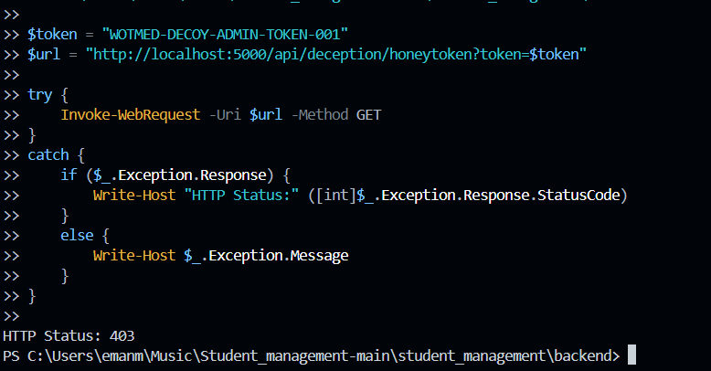

Documents the observed HTTP 403 response during the honeytoken test.

### 02. Honeytoken — High-Severity Telemetry

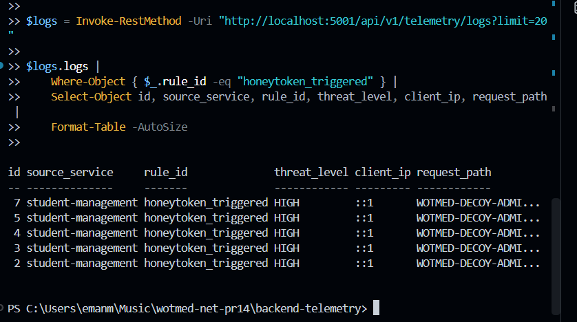

Documents the honeytoken-related event observed in the telemetry interface.

### 03. Honeytoken — SOC Dashboard

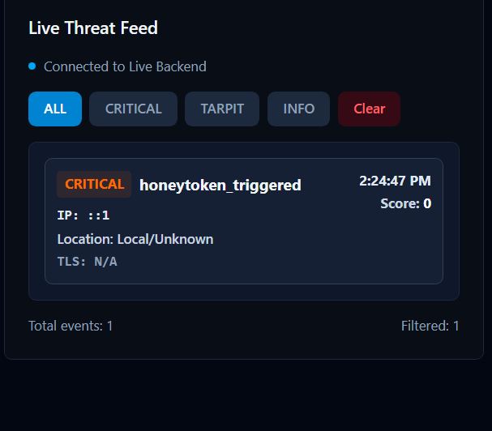

Documents the corresponding honeytoken alert displayed in the SOC Dashboard.

### 04. Honeytoken — Live Event

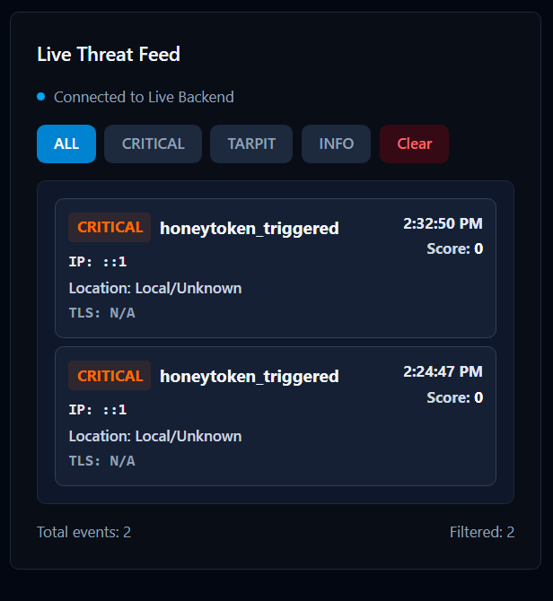

Documents the live event observed during the honeytoken verification.

## 4. Canary Endpoint Evidence

### 05. Canary Endpoint — HTTP 403

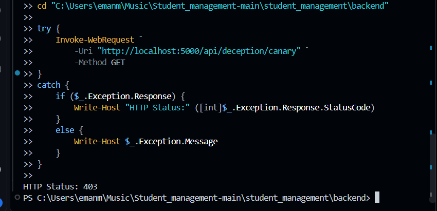

Documents the observed HTTP 403 response during the canary endpoint test.

### 06. Canary — Telemetry Event

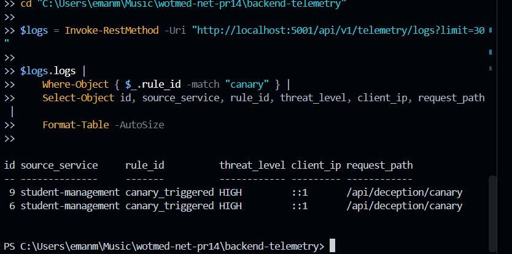

Documents the canary-related event observed in the telemetry interface.

### 07. Canary — SOC Dashboard

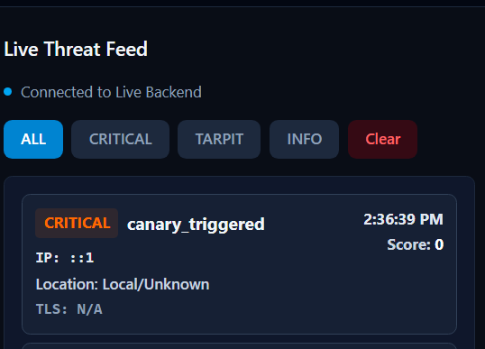

Documents the corresponding canary alert displayed in the SOC Dashboard.

### 08. Canary — Live Event

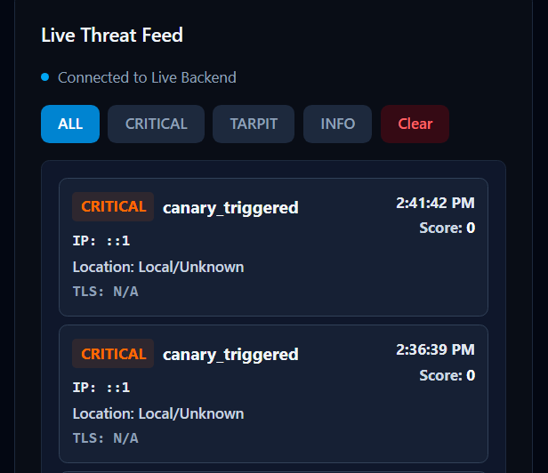

Documents the live event observed during the canary endpoint verification.

## 5. Canary File Evidence

### 09. Canary File Endpoint — HTTP 403

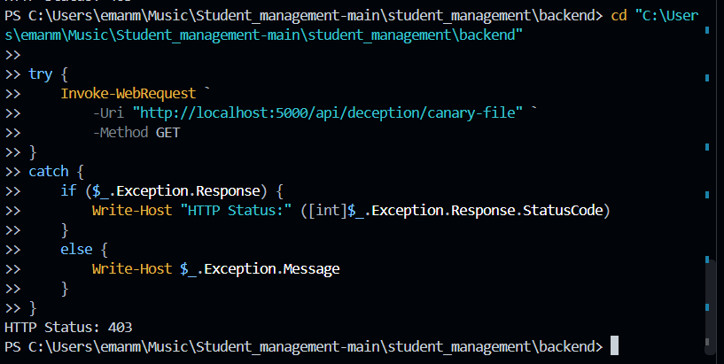

Documents the observed HTTP 403 response during the canary-file test.

### 10. Canary File — High-Severity Telemetry

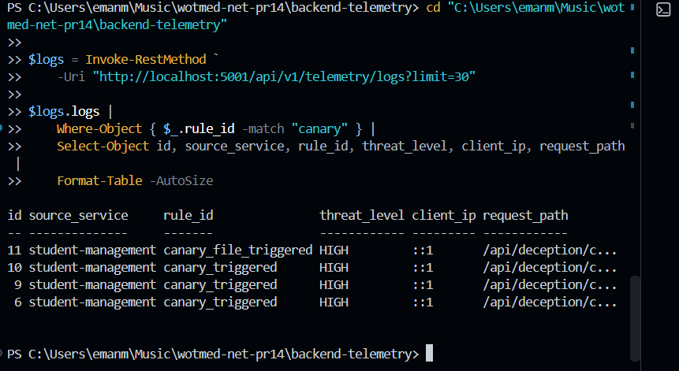

Documents the canary-file-related event observed in the telemetry interface.

### 11. Canary File — SOC Dashboard

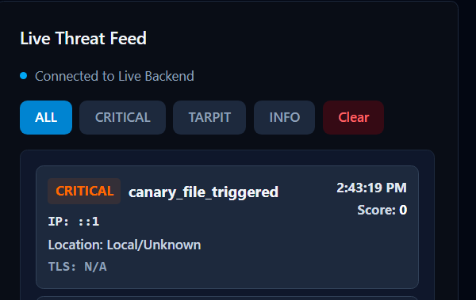

Documents the corresponding canary-file alert displayed in the SOC Dashboard.

### 12. Canary File — Live Event

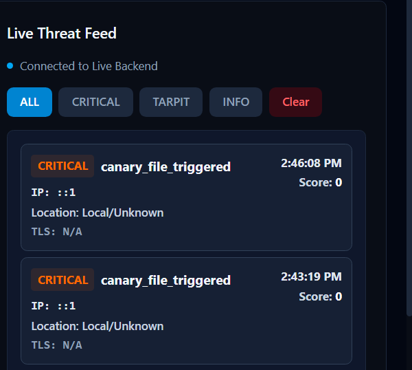

Documents the live event observed during the canary-file verification.

## 6. Decoy Admin Evidence

### 13. Decoy Admin Endpoint — HTTP 403

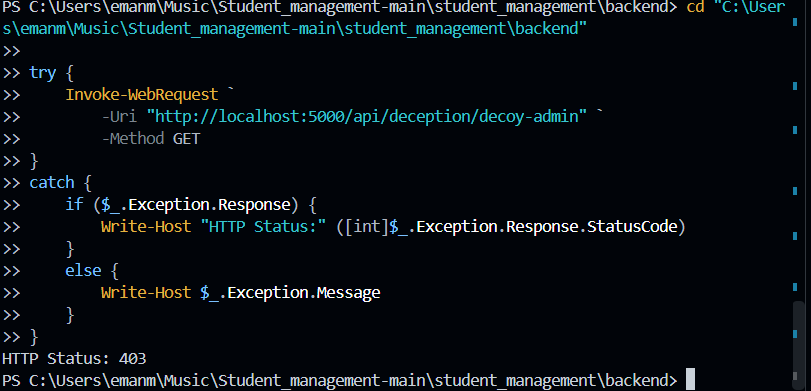

Documents the observed HTTP 403 response during the decoy admin test.

### 14. Decoy Admin — High-Severity Telemetry

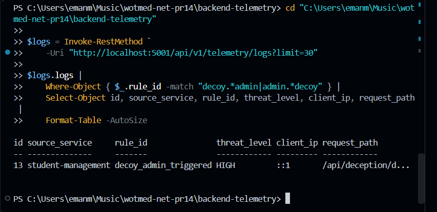

Documents the decoy-admin-related event observed in the telemetry interface.

### 15. Decoy Admin — SOC Dashboard

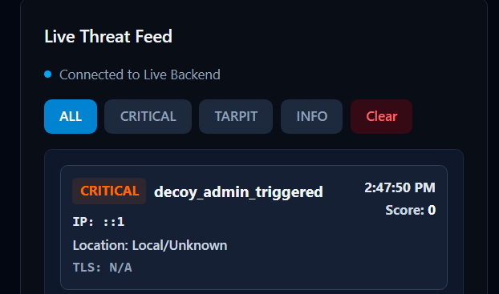

Documents the corresponding decoy admin alert displayed in the SOC Dashboard.

### 16. Decoy Admin — Live Event

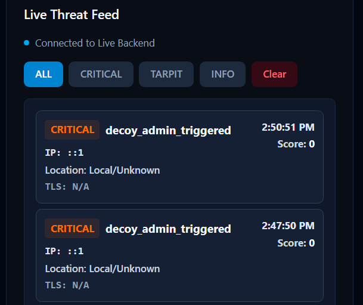

Documents the live event observed during the decoy admin verification.

## 7. Verification Notes

The screenshots provide evidence from local testing of the configured deception resources and the associated monitoring interfaces.

- Endpoint screenshots document the observed HTTP responses.
- Telemetry screenshots document the corresponding events visible in the local telemetry interface.
- SOC Dashboard screenshots document the related alerts visible during testing.
- Live-event screenshots provide additional evidence of event visibility during the recorded tests.

The screenshots should be interpreted as evidence of the specific behavior visible in each capture. They do not independently establish production deployment, persistent database storage, or the correctness of the complete threat-scoring pipeline.

## 8. Scope of Contribution

My contribution focuses on **Demo App & Deception Testing**: exercising the configured deception resources, checking their responses, and verifying the resulting events in the available telemetry and SOC Dashboard interfaces.

This document records the evidence for that testing work without claiming ownership of the telemetry backend or SOC Dashboard implementation.
